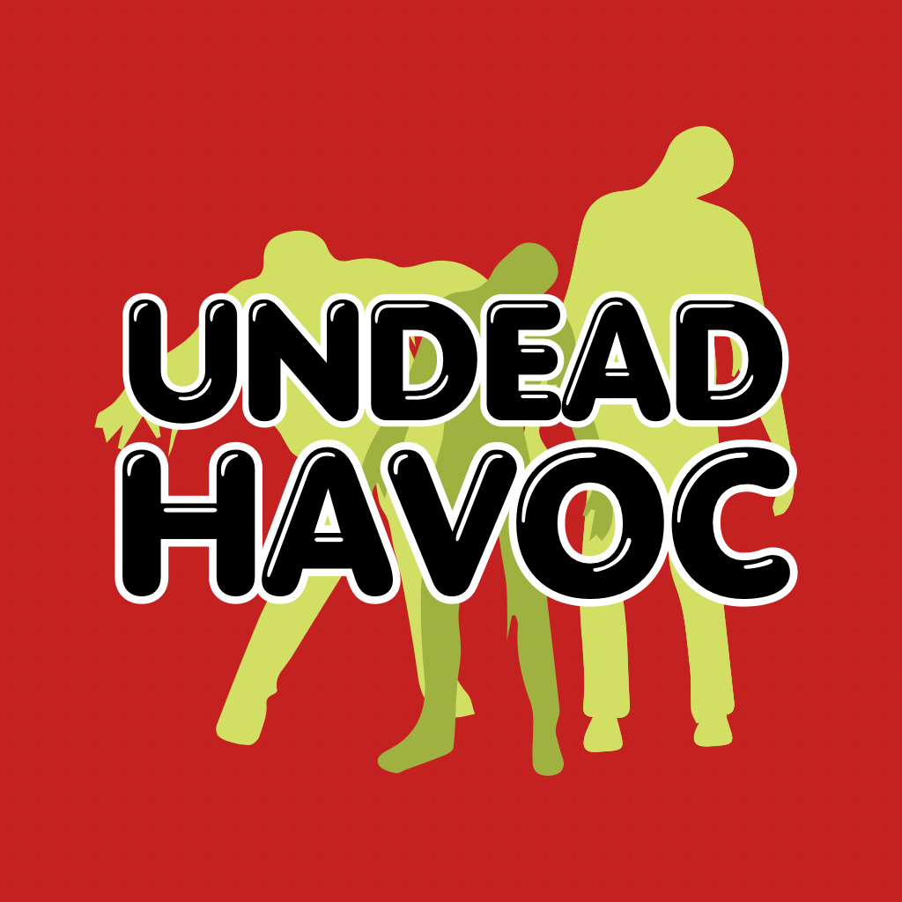
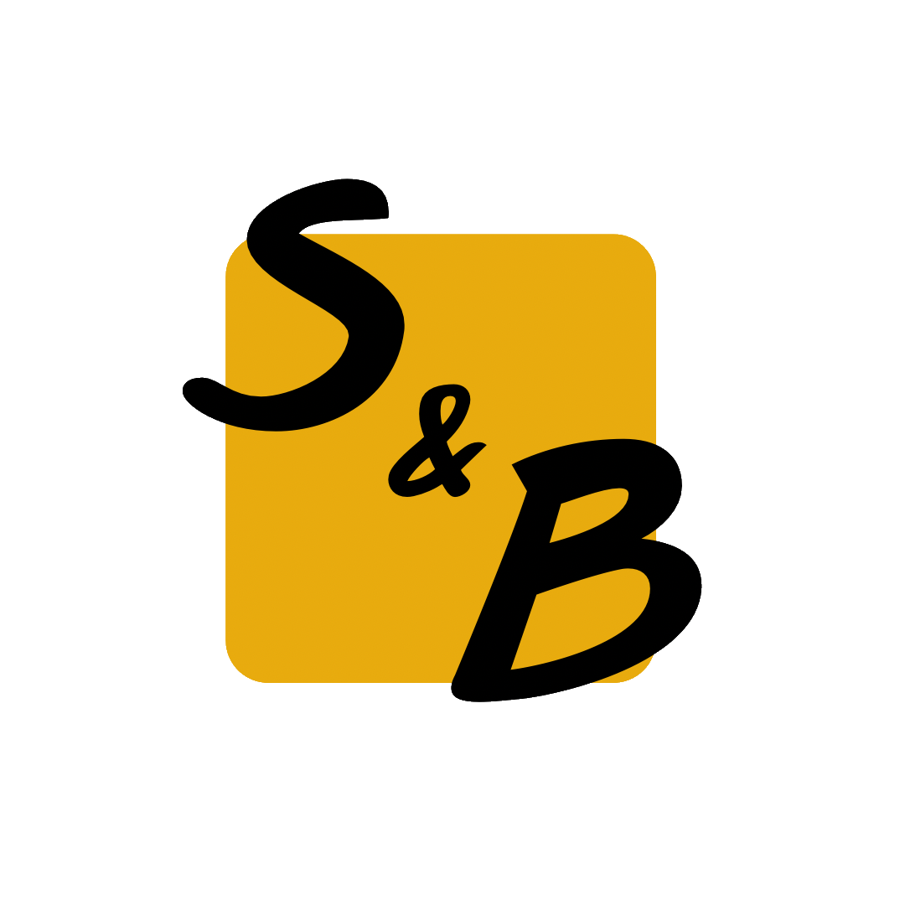

<div align="center">



# Undead Havoc

**A fast-paced 3D first-person zombie shooter built with Unity and C#.**


[Overview](#-overview) · [Features](#-features) · [Screenshots](#-screenshots) · [Controls](#-controls) · [Getting Started](#-getting-started) · [Project Structure](#-project-structure) · [Team](#-team)

</div>

---

## 🎮 Overview

The world has fallen to the undead. In **Undead Havoc** you are one of the last survivors, fighting through hostile environments against ever-growing waves of zombies. Manage your ammo, pick the right weapon for the moment, and stay alive as long as you can.

> Final project for **Advanced Unity Game Engine**, KBTU, Spring 2023/24.

## ✨ Features

- **Wave-based survival**: every wave is bigger and tougher than the last.
- **Arsenal of weapons**: pistol, shotgun and explosives, each with its own role.
- **Responsive first-person controls** for tight, fast combat.
- **Atmospheric environments** with detailed models and lighting.
- **Dynamic soundtrack** that builds tension throughout the fight.

## 📸 Screenshots

<!-- Add 3–4 screenshots or a short GIF to docs/screenshots/ and uncomment: -->
<!--
| Gameplay | Weapons | Menu |
|:--:|:--:|:--:|
|  |  |  |
-->

*Screenshots coming soon.*

## 🕹️ Controls

> Update this table to match the actual input bindings of your project.

| Action | Key |
|---|---|
| Move | `W` `A` `S` `D` |
| Look | Mouse |
| Shoot | Left Mouse Button |
| Reload | `R` |
| Switch weapon | `1` `2` `3` / Mouse Wheel |
| Jump | `Space` |
| Pause | `Esc` |

## 🚀 Getting Started

### Requirements

- [Unity Hub](https://unity.com/download)
- Unity Editor **2022.3 LTS or newer** (check `ProjectSettings/ProjectVersion.txt` for the exact version)
- Git

### Run the project

```bash
git clone https://github.com/Samatuly/Advanced-Unity.git
```

1. Open **Unity Hub** → **Add** → select the cloned folder.
2. Open the project with the matching Editor version.
3. Open the main scene from `Assets/Scenes/` and press **Play**.

### Build

`File → Build Settings → select platform → Build`

## 🗂️ Project Structure

```
Advanced-Unity/
├── Assets/            # Scenes, scripts, sprites, audio, prefabs
├── Packages/          # Unity package manifest
├── ProjectSettings/   # Unity project configuration
└── README.md
```

## 🛠️ Built With

- **Unity**: game engine
- **C#**: gameplay scripting
- **Visual Studio Code**: editor

## 🗺️ Roadmap

- [ ] More enemy types and a boss wave
- [ ] More weapons and upgrades
- [ ] Save system and high score table
- [ ] Gamepad support

## 💬 Feedback

Ideas or bug reports are welcome. Open an [issue](https://github.com/Samatuly/Advanced-Unity/issues) and describe what you found.

## 👥 Team

| | |
|---|---|
| **Course** | Advanced Unity Game Engine |
| **Instructor** | Dmitrii Tuchashvili |
| **Developer** | Samatuly Serikbolsyn (21B030910) |

<div align="center">



</div>
